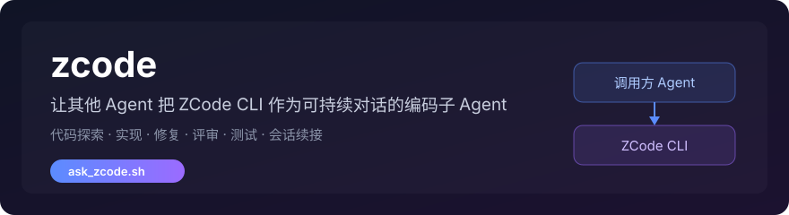
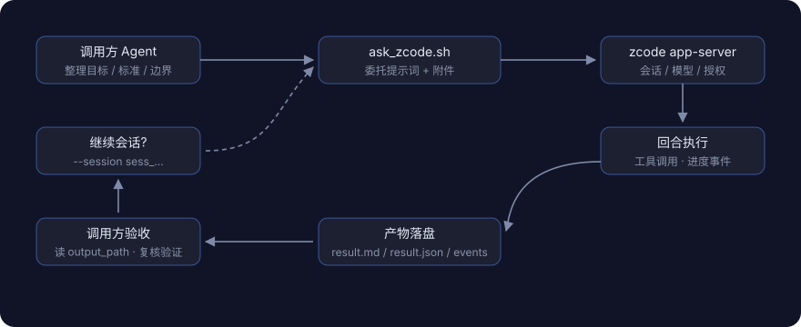

<p align="center">
  
</p>

把代码探索、实现、修复、评审和测试交给持久化编码 Agent，支持继续同一任务。

调用方负责说明目标、约束和验收方式；ZCode 负责在指定工作区内完成任务。一次任务结束后，调用方可以检查结果，也可以继续同一个会话处理后续问题。

本项目受 [oil-oil/codex](https://github.com/oil-oil/codex) 启发：它让 Agent 调用 Codex CLI，这个项目让 Agent 调用 ZCode CLI，尽量沿用相同的思路、结构和输出契约。

## 适合处理的任务

- 探索代码库，追踪入口、依赖和调用链。
- 实现边界清楚的功能或修复。
- 评审代码，并引用具体文件和行号。
- 运行测试、类型检查或构建，整理验证结果。
- 继续已有 ZCode 会话，不重复传递完整背景。

## 安装

```bash
npx skills add Gaming33/zcode -g -y
```

运行前需要准备：

- 已安装并登录 [ZCode 桌面端](https://zcode.z.ai/)（共享凭据位于 `~/.zcode/v2/credentials.json`），且 `zcode` CLI 可用（随桌面端附带，或自行加入 PATH）。
- macOS、Linux。
- `jq`。包装脚本使用它处理协议帧与事件。
- `node`。zcode CLI 本身的运行依赖；同时用于解密共享凭据存储中的 API Key。

安装后，其他 Agent 可以在用户明确要求"使用 ZCode"时调用这个 Skill。

## 让 Agent 调用 ZCode

可以直接向支持 Skill 的 Agent 提出要求：

```text
使用 ZCode 检查这个项目的登录流程，修复刷新失败的问题，并运行相关测试。
```

Agent 会整理任务目标、完成标准、重要文件和安全边界，再调用包装脚本。调用方仍然负责检查工作区改动和重新运行真实验证命令。

## 包装脚本

macOS 与 Linux：

```bash
~/.agents/skills/zcode/scripts/ask_zcode.sh \
  "检查登录流程，修复刷新失败的问题，并运行相关测试" \
  --workspace "/path/to/repo" \
  --file "src/auth.ts"
```

脚本通过 `zcode app-server --stdio` 协议驱动 ZCode，默认以 `yolo`（最高权限）模式创建会话，并自动应答协议内的工具授权。只有明确需要限制权限时，才为新会话指定只读模式：

```bash
~/.agents/skills/zcode/scripts/ask_zcode.sh \
  "追踪请求路径，并引用涉及的文件和行号" \
  --workspace "/path/to/repo" \
  --read-only
```

## 调用流程

<p align="center">
  
</p>

每次运行都会建立独立的产物目录，避免并行任务互相覆盖。脚本成功后输出：

```text
session_id=<sess_...>
runtime=app-server
output_path=<file>
result_path=<file>
events_path=<file>
elapsed=<seconds>s
```

调用方通常先读取 `output_path`，再检查工作区和验证结果。运行失败时，可以通过 `result_path`、`events_path` 和 `protocol.log` 判断失败原因。

| 产物 | 内容 | 使用场景 |
| --- | --- | --- |
| `output_path` | 精简的 Markdown 结果 | 阅读结论、改动与有效执行记录 |
| `result_path` | 结构化运行状态 | 判断成功、失败、退出码和会话信息 |
| `events_path` | 会话事件 JSONL | 诊断中断、错误和恢复问题 |
| `protocol.log` | 协议原始帧 | 追踪握手、模型与鉴权问题 |

## 继续已有会话

首次任务返回 `session_id` 后，可以继续同一个 ZCode 会话：

```bash
~/.agents/skills/zcode/scripts/ask_zcode.sh \
  "继续修复刚才发现的问题，并补充回归测试" \
  --session <session_id>
```

续接会话保留原工作区上下文与模型配置，不能指定 `--read-only`；需要受限权限时开启新会话。

## 模型选择

常规调用不需要指定模型：包装脚本会从本机共享凭据与 Provider 配置中同步账号可用的模型，并选择第一个可用模型。确有需要时通过环境变量覆盖：

```bash
# 固定模型
ZCODE_SKILL_MODEL=account:bigmodel-individual-coding-plan/GLM-5.3 \
  ask_zcode.sh "任务描述"

# 同时指定思考档位
ZCODE_SKILL_MODEL=account:bigmodel-individual-coding-plan/GLM-5.3-Flash$high \
  ask_zcode.sh "任务描述"
```

GLM 模型声明了思考档位；脚本会先尝试本机默认档位，被拒时按"用户指定 → 本机 Provider 配置 → high/max/low"的顺序逐个重试。

### 持久化默认值

不想每次都指定？把惯用值写进配置文件：

```bash
mkdir -p ~/.config/zcode-skill
cat > ~/.config/zcode-skill/env <<'EOF'
ZCODE_SKILL_MODEL=account:bigmodel-individual-coding-plan/GLM-5.3-Flash$max
EOF
```

格式为 KEY=VALUE，支持 `#` 注释。优先级：**调用方环境变量 > 配置文件 > 自动选择**，所以临时覆盖只需在单次命令前加环境变量。注意两点：配置文件的模型固定值只作用于新会话，续接会话始终保留自己的模型（显式 export 的 `ZCODE_SKILL_MODEL` 仍可覆盖续接）；`ZCODE_SKILL_ENV_FILE` 可以更换文件路径。

## 常用参数

| 参数 | 作用 |
| --- | --- |
| `--workspace <path>` | 指定 ZCode 工作目录 |
| `--file <path>` | 提供优先阅读的入口文件，可以重复使用 |
| `--image <path>` | 向 ZCode 附加图片（png/jpg/gif/webp） |
| `--read-only` | 创建只读会话（plan 模式） |
| `--mode <mode>` | 显式指定权限模式（build/edit/plan/yolo/guarded） |
| `--session <id>` | 继续已有会话 |
| `--notify` | 长任务结束后发送桌面通知 |
| `--output <path>` | 指定 Markdown 结果路径 |

完整参数可以通过脚本的 `--help` 查看。

## 权限模式

默认 `yolo`：全自动执行，工具授权由包装脚本自动应答。`--read-only` 映射为 `plan` 模式，只读不改文件。其余模式（build 每步确认、edit 自动改文件、guarded 拦截危险命令）面向交互式场景，委托运行时可通过 `--mode` 传入，但包装脚本仍会自动应答授权请求，逐项确认不会生效。

## 委托和验收

每次只委托一个边界清楚的任务。提示词应当说明：

1. 需要修改或查明什么，以及不应改动的范围。
2. 预期行为和必须覆盖的边界情况。
3. 需要运行的真实测试、检查或构建命令。
4. 不执行 `git add`、`git commit`，不顺手重构无关代码。
5. 最终报告需要包含改动原因、涉及文件、验证结果和未完成事项。

ZCode 返回"测试通过"不能替代调用方验收。调用方需要检查测试是否被删除、跳过或弱化，并重新运行仓库中的真实验证命令。

### 运行指引（给调用方 Agent）

- 回合可能持续数分钟到数十分钟：给足 Bash 超时，或以后台方式运行并轮询 `result_path`。
- 进度在 stderr（`[zcode]` 前缀，含心跳行）；最终结果在 stdout 结尾的 key=value 行；产物在 `output_path` / `result_path`。
- 退出码 0 = 成功；非 0 = 失败，读 `result_path` 定位原因。
- 不要委托 ZCode 直接修改本 skill 正在运行的脚本；如需修改 skill 自身，先复制工作副本。

## 与 codex Skill 的差异

| 能力 | oil-oil/codex | 本项目 |
| --- | --- | --- |
| 驱动方式 | `codex exec` + JSONL | `zcode app-server` JSON 协议 |
| 会话续接 | `--session <thread_id>` | `--session <sess_...>` |
| 只读模式 | `--read-only`（沙箱） | `--read-only`（plan 模式） |
| 图片 | `--image` 原生支持 | `--image` 会话附件 |
| 结构化输出 `--output-schema` | 支持 | 暂不支持 |
| 一次性会话 `--ephemeral` | 支持 | 暂不支持 |
| Windows 脚本 | `ask_codex.ps1` | 暂未提供（欢迎 PR） |

## 开发验证

macOS 与 Linux 包装脚本的回归测试（内置一个脚本化的 mock app-server，不依赖真实登录）：

```bash
bash tests/test_ask_zcode.sh
```

测试覆盖成功运行、回合失败、模型固定、默认模型选择、权限自动应答与续接会话。

## 配置、依赖与使用边界

需要已登录的 ZCode 桌面端与可用的 `zcode` CLI；macOS/Linux 使用 Bash。包装脚本可从任意实际 Skill 目录调用。

仅在用户明确要求委托时使用。任务文件与指令会交给本机配置的模型；继续原会话时核对会话与目录，避免混入无关任务。

使用示例：

```text
用 ZCode 处理这个明确的代码修改。
```
